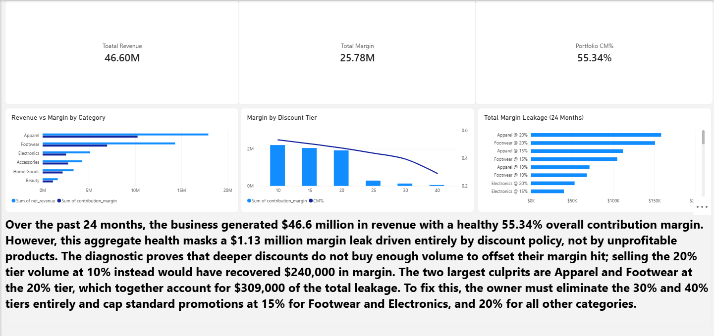

# Retail Demand & Profitability Diagnostic

**A 24-month, 30-store POS profitability audit ending in a one-page decision memo.**

## The Hook
I analyzed **970,838 line items** across a 30-store retail chain over 24 months. The business generated $46.6M in revenue at a healthy 55.34% contribution margin. However, the diagnostic uncovered a **$1.13M hidden margin leak**. The problem was not loss-making products—it was discount policy. By selling the 20% discount tier volume at 10% instead, the business could have recovered **$240,000 in margin**. 

## Project Structure
- `sql/` — Modular SQL analytical layer (Postgres 16 in Docker).
- `notebooks/` — 01 Data Audit, 02 Diagnostics (SQL, Pandas, Matplotlib).
- `dashboard/` — Power BI one-page decision surface.
- `deliverables/` — One-page executive recommendation memo (PDF/Markdown).
- `docs/` — Data dictionary, metric definitions, cleaning log, quality scorecard.

## Key Findings
1. **The 20% Tier is an Over-Discount:** The 10% tier carries more absolute margin ($2.20M) than the 20% tier ($1.92M). The business was over-discounting by 10 percentage points.
2. **The Leakage Concentration:** Apparel@20% and Footwear@20% together account for $309K (27%) of the total $1.13M leakage.
3. **No Loss-Making SKUs:** The lowest-margin SKU (Wireless Earbuds) still earned 41.7%. SKU repricing is not the answer; discount policy is.

## The Dashboard

## How to Reproduce
1. `docker compose up -d`
2. `python scripts/01_build_staging.py`
3. Run the SQL files in `sql/` sequentially, or run the Jupyter notebooks.

## Executive Memo
Read the full [recommendation memo here](deliverables/memo.md).