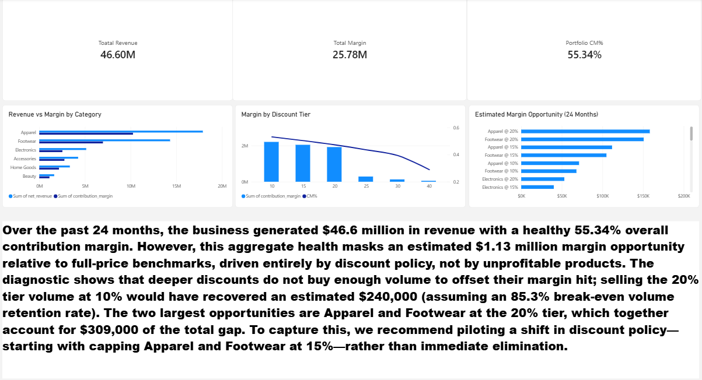

# MEMORANDUM

**To:** Owner-Operator, Regional Retail Chain  
**From:** PADMABHUSHAN  
**Date:** 2026-11-01  
**Subject:** Action Plan to Evaluate a \$1.13M Estimated Margin Opportunity  
**Supporting file:** `dashboard/retail_profitability_diagnostic.pbix` · `notebooks/02_diagnostics.ipynb`

---

## Executive Summary

Over the past 24 months, the business generated \$46.6 million in revenue with a healthy 55.34% overall contribution margin. However, this aggregate health masks an **estimated \$1.13 million margin opportunity** relative to full-price category benchmarks. The diagnostic shows that deeper discounts do not buy enough volume to offset their margin hit. Selling the 20% tier volume at 10% would have recovered an estimated \$240,000 (assuming an 85.3% break-even volume retention rate). The two largest opportunities are Apparel and Footwear at the 20% tier, which together account for \$309,000 of the total benchmark gap. To capture this, we recommend piloting a shift in discount policy rather than immediate elimination.

---

## The Five Actions (Proposed Pilots)

*Note: Because this dataset lacks A/B test data, these actions are framed as hypotheses to be tested in a controlled pilot (e.g., 4 weeks, 3-5 representative stores) to measure true price elasticity and promotion lift.*

| # | Action | Evidence | Expected Impact | Owner |
|---|---|---|---|---|
| **1** | **Pilot the removal of 30% and 40% discount tiers.** | These tiers generate <1% of lines and represent a combined \$133K opportunity cost vs full-price benchmarks. | Protects ~\$5,500/month (if volume holds) | Sales Lead |
| **2** | **Test a 15% discount cap on Apparel and Footwear.** | Apparel@20% (\$158K) and Footwear@20% (\$151K) represent 27% of total opportunity cost. | Recovers ~\$13,000/month (pending elasticity test) | Merchandising |
| **3** | **Shift the default promotional tier from 20% to 10%.** | The 10% tier generates \$2.20M absolute margin vs \$1.92M at 20%. Sensitivity analysis shows break-even is an 85.3% volume retention rate. | Recovers ~\$10,000–\$20,000/month | Marketing |
| **4** | **Pilot a shelf-space reallocation toward Beauty and Accessories.** | These categories have 64-68% margins vs Footwear (48.7%) and Electronics (49.3%). | Improves blended margin by 3-5 points (if basket mix holds) | Merchandising |
| **5** | **Maintain current SKU pricing (Do not delist).** | The lowest-margin SKU still earns 41.7% margin. No SKUs are loss-making. | Preserves volume; avoids destroying cash flow | Purchasing |

---

**What We Did Not Measure:**
This analysis is limited to the transactional POS data provided. We did not measure price elasticity or promotion lift (no A/B test data exists), so we cannot predict exactly how much volume will drop if you cap discounts. The \$1.13M figure represents an estimated margin opportunity relative to a full-price category benchmark, not a guaranteed recovery. We also did not measure Customer Lifetime Value: because 65% of transactions are guest checkouts and the observation window is 24 months, any CLV number would be fabricated precision. Finally, we did not measure delivery or fulfillment costs, as those fields do not exist in this dataset. The recommendations above are based purely on optimizing the unit economics of the products and promotions captured at the register.

---

## Appendix: Data Integrity
This analysis is based on 970,838 line items spanning 24 months. The dataset was audited, and the load reconciles to the vendor summary file with zero delta for all 30 stores. Refunds are retained in the fact table (0.84% of revenue) and net out at the category and SKU grain. The discount tier structure was verified against distinct values, confirming seven nominal tiers (0%, 10%, 15%, 20%, 25%, 30%, 40%).

---

## Appendix: One-Page Dashboard
